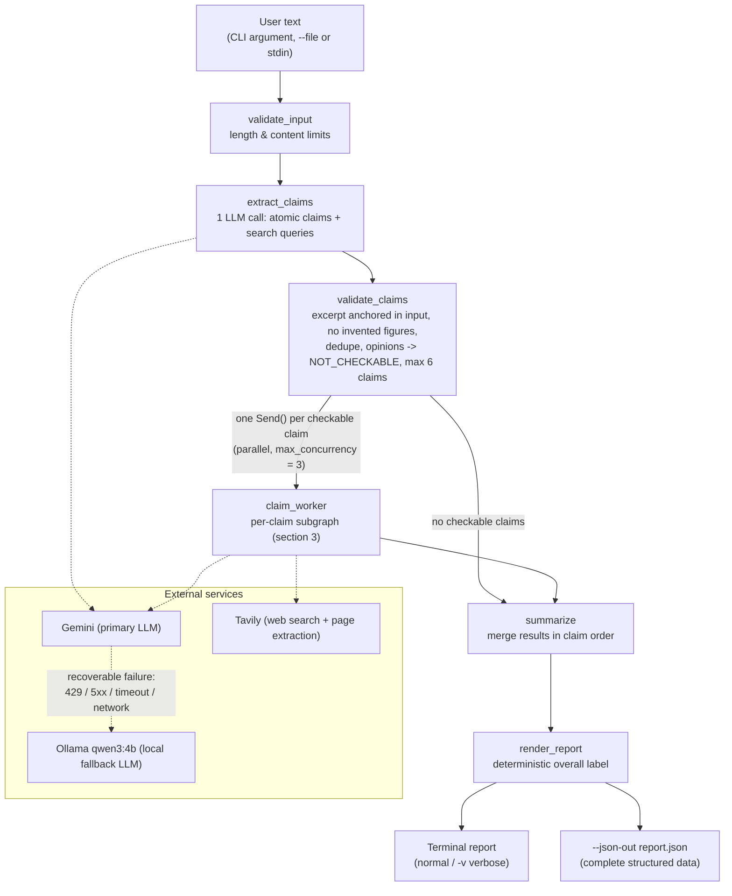
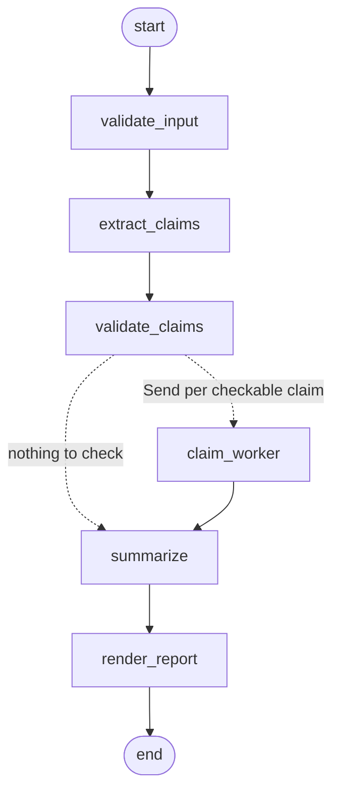
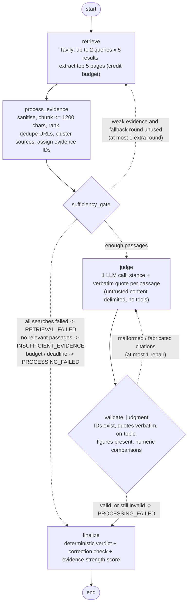
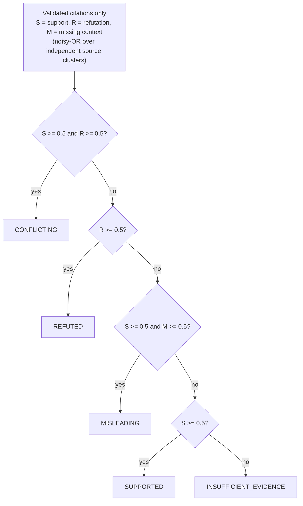
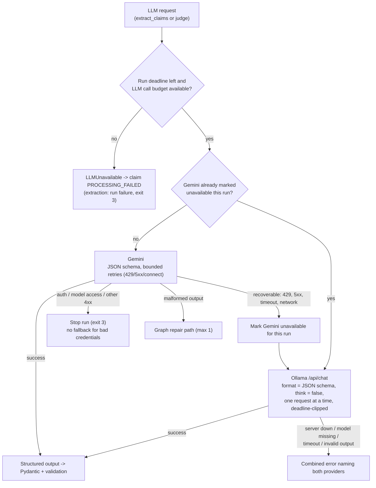

# factcheck: agent workflow

How a paragraph becomes a fact-check report. The two LangGraph diagrams (sections 2 and 3) were
exported from the compiled graphs in `src/factcheck/graph.py` with
`graph.get_graph().draw_mermaid()`. Only the edge labels were added by hand. The diagrams render on
GitHub, in VS Code with a Mermaid extension, or in `docs/workflow.html` (open it in a browser).

## 1. End-to-end overview

## 2. Main graph (LangGraph `build_graph`)

## 3. Per-claim subgraph (LangGraph `build_claim_graph`)

### Deterministic verdict rules (inside `finalize`)

The model's own proposed verdict is recorded, but it never decides the outcome.

## 4. LLM provider chain and fallback (`llm.FallbackLLM`)

## Step reference

| Step | Kind | What it does | Limits |
|---|---|---|---|
| `validate_input` | code | Cleans control and bidi characters; rejects empty or too-long input | 4,000 characters |
| `extract_claims` | LLM | Splits text into atomic claims with exact excerpts and search queries | 1 call (+1 retry if malformed) |
| `validate_claims` | code | Drops claims with invented excerpts or figures, instructions and duplicates; marks opinions and predictions NOT_CHECKABLE | max 6 checkable claims |
| `claim_worker` | graph | Runs the per-claim subgraph for each claim in parallel | concurrency 3, recursion limit 25 |
| `retrieve` | Tavily | Searches (and one fallback round with other queries if evidence is weak); extracts full pages | 40 credits per run |
| `process_evidence` | code | Sanitises and chunks; ranks; canonical URL dedupe; independence clusters; evidence IDs | 8 passages per claim |
| `sufficiency_gate` | code | Chooses fallback round, judge or finish; separates technical failure from no evidence | — |
| `judge` | LLM | Assesses each passage: stance, directness, verbatim quote, numeric comparison | 1 call (+1 repair) |
| `validate_judgment` | code | Rejects unknown IDs, non-verbatim or off-topic quotes, missing figures, mismatched measurements | — |
| `finalize` | code | Verdict rules, grounded correction, 0–100 evidence-strength score with caps | — |
| `summarize` / `render_report` | code | Overall label, terminal report, JSON | — |

Every run is bounded by a 180 s deadline, a 14-call LLM budget, a 40-credit search budget and a
single fallback/repair per claim. Each limit stops work cleanly and marks unfinished claims
`PROCESSING_FAILED`.
